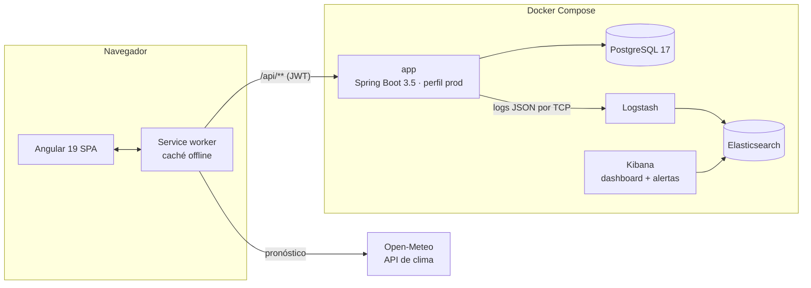
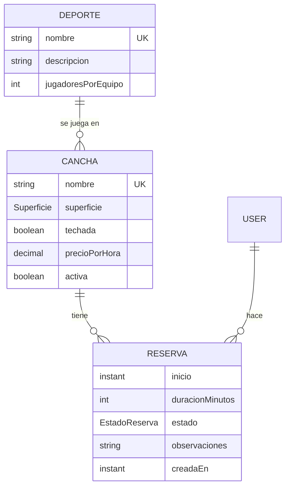

# Arquitectura

## Componentes



- El **frontend** (Angular) se compila dentro del jar y lo sirve el mismo Spring Boot en `:8080`.
- El **service worker** intercepta los pedidos y aplica las estrategias de caché (ver [pwa.md](pwa.md)).
- La **autenticación** es JWT: el token viaja en el header `Authorization` y nunca se envía a Open-Meteo.
- Los **logs** salen de la app con `logstash-logback-encoder` hacia `logstash:5000` (ver [elk.md](elk.md)).

## Modelo de datos

Definido en [`clubreservas.jdl`](../clubreservas.jdl) y generado con `jhipster jdl`.



`EstadoReserva`: `CONFIRMADA`, `CANCELADA`, `FINALIZADA`. `Superficie`: `CESPED_SINTETICO`, `POLVO_DE_LADRILLO`, `CEMENTO`, `PARQUET`.

## Backend

Estructura en capas de JHipster, verificada con ArchUnit (`TechnicalStructureTest`):

| Capa         | Clases relevantes                                                                                    |
| ------------ | ---------------------------------------------------------------------------------------------------- |
| `web.rest`   | `ReservaResource` (cancelar, filtro por usuario, permisos), `AuthenticateController` (logs de login) |
| `web.filter` | `RegistroPeticionesFilter`: log de cada petición a `/api` y usuario en el MDC                        |
| `service`    | `ReservaService` (reglas de negocio), `ReglaReservaException`, `LatidoService` (log cada minuto)     |
| `repository` | `ReservaRepository`: búsqueda de superposiciones y conteo de reservas activas                        |
| `config`     | `SecurityConfiguration` (CSP y headers), `ClockConfiguration` (reloj inyectable para tests)          |

Las reglas de negocio lanzan `ReglaReservaException` (capa service); el controller la convierte en un **400** con el motivo en `detail`, que el frontend muestra al usuario.

## Contenedores (`docker-compose.yml`)

| Servicio        | Imagen                                         | Puerto (host) | Rol                                                |
| --------------- | ---------------------------------------------- | ------------- | -------------------------------------------------- |
| `app`           | `clubreservas:latest` (Dockerfile multi-etapa) | 8080          | La aplicación (perfil prod)                        |
| `postgresql`    | `postgres:17.4`                                | 5432          | Base de datos (volumen `postgresql-data`)          |
| `elasticsearch` | `elasticsearch:9.5.4`                          | 9200          | Almacena los logs (volumen `elasticsearch-data`)   |
| `logstash`      | `logstash:9.5.4`                               | 5001 → 5000   | Recibe los logs de la app                          |
| `kibana`        | `kibana:9.5.4`                                 | 5601          | Dashboard y alertas                                |
| `elk-setup`     | `elasticsearch:9.5.4`                          | —             | Una vez: usuarios, rol y plantilla del índice      |
| `kibana-setup`  | `elasticsearch:9.5.4`                          | —             | Una vez: data views, dashboard, conectores, reglas |

Todos los puertos se publican solo en `127.0.0.1`. Las contraseñas están en `.env` (no versionado; plantilla en `.env.example`). Logstash se publica en el 5001 porque en macOS el 5000 lo usa AirPlay.

## Estructura del repo

```
final-isa/
├── .github/workflows/pipeline.yml   CI: tests, seguridad, imagen, E2E y DAST
├── .zap/rules.tsv                   Excepciones justificadas de ZAP
├── audit-ci.jsonc · .semgrepignore · .trivyignore · .gitleaks.toml   Excepciones de las puertas
├── clubreservas.jdl                 Modelo de datos (JHipster)
├── docker-compose.yml · Dockerfile · start.sh · .env.example
├── elk/                             Logstash, Kibana, setup, dashboard (ndjson), reglas, generar-trafico.sh
├── playwright.config.ts
├── src/main/docker/                 Compose que generó JHipster (no se usan: el principal es el de la raíz)
├── src/main/java/...                Backend
├── src/main/webapp/...              Frontend Angular (PWA)
├── src/test/java/...                Tests de unidad e integración
├── src/test/playwright/             Tests E2E
├── workbox.config.cjs               Service worker (Workbox): precache y estrategias de caché
└── docs/                            Esta documentación
```
