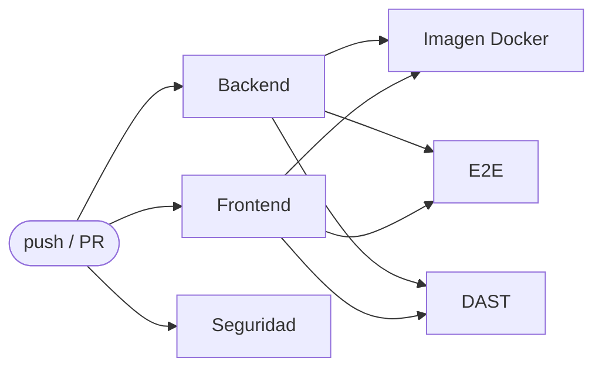

# Integración continua (GitHub Actions)

El pipeline (`.github/workflows/pipeline.yml`) corre en **cada push** a cualquier rama y en **cada pull request a `main`**. Si llega un push nuevo a la misma rama, cancela la corrida anterior.

## Jobs

| Job                                         | Qué hace                                                                                           | Artifact                    |
| ------------------------------------------- | -------------------------------------------------------------------------------------------------- | --------------------------- |
| **Backend (Tests)**                         | `./mvnw verify`: unidad, integración (PostgreSQL con Testcontainers), ArchUnit, checkstyle         | `backend-reportes` (JaCoCo) |
| **Frontend (Tests)**                        | `npm run lint` + Jest                                                                              | `frontend-reportes`         |
| **Seguridad (SCA, SAST, secretos, config)** | audit-ci, Semgrep, Gitleaks y Trivy config (detalle abajo)                                         | —                           |
| **Imagen Docker (Trivy)**                   | Construye la imagen con el `Dockerfile` y la escanea con Trivy                                     | —                           |
| **E2E (Playwright)**                        | Levanta app + PostgreSQL con el compose (contraseñas generadas en cada corrida) y corre Playwright | `playwright-reporte`        |
| **DAST (OWASP ZAP)**                        | Levanta app + PostgreSQL y corre el baseline scan de ZAP 2.17.0                                    | `zap-reporte`               |

Todas las acciones están **fijadas por SHA** (no por tag) y las imágenes de las herramientas, por versión: `semgrep/semgrep:1.184.0`, `aquasec/trivy:0.75.0`, `audit-ci@7.1.0`, ZAP `2.17.0`.

## Puertas de seguridad

Mismas ideas que el taller _tienda-segura_:

| Puerta        | Herramienta                  | Qué detecta                                              | Falla con             |
| ------------- | ---------------------------- | -------------------------------------------------------- | --------------------- |
| SCA           | audit-ci (sobre `npm audit`) | Vulnerabilidades en dependencias que llegan al navegador | HIGH o CRITICAL       |
| SAST          | Semgrep (`--config auto`)    | Patrones peligrosos en el código                         | Cualquier hallazgo    |
| Secretos      | Gitleaks                     | Claves y contraseñas en el código y el historial         | Cualquier hallazgo    |
| Configuración | Trivy config                 | Dockerfiles y configuración insegura                     | HIGH o CRITICAL       |
| Contenedor    | Trivy image                  | Vulnerabilidades del SO y las librerías de la imagen     | HIGH o CRITICAL       |
| DAST          | OWASP ZAP baseline           | Headers, CSP, cookies y errores de la app en ejecución   | Cualquier WARN o FAIL |

## Excepciones

Regla del equipo: **solo se aceptan excepciones revisadas una por una**, con su ID y su motivo. Cualquier hallazgo nuevo sigue frenando el pipeline.

| Archivo          | Excepción                                                                             | Motivo                                                                                                          |
| ---------------- | ------------------------------------------------------------------------------------- | --------------------------------------------------------------------------------------------------------------- |
| `audit-ci.jsonc` | 7 avisos de Angular 19 (HttpTransferCache, hidratación, router SSR, i18n, formatDate) | Sin parche en la rama 19.x; la app no usa SSR, hidratación ni i18n, y los formatos de fecha son fijos           |
| `audit-ci.jsonc` | devDependencies (`skip-dev`)                                                          | Herramientas de build: no llegan al navegador                                                                   |
| `.trivyignore`   | CVE-2026-47884, CVE-2026-47890 (`spring-webmvc`)                                      | XsltView y SSE con _fragments_: la app no los usa; el parche está solo en Spring 7                              |
| `.semgrepignore` | `user.csv` de Liquibase                                                               | Usuarios de ejemplo de JHipster (`admin/admin`, `user/user`), contraseñas públicas                              |
| `.semgrepignore` | Secreto JWT y helper de Testcontainers en `src/test`                                  | Solo para tests                                                                                                 |
| `.gitleaks.toml` | `.yo-rc.json`, `application-dev.yml`, config y un test de `src/test`, `.env.example`  | Secretos de desarrollo/test y valores de ejemplo. El de producción no está en el repo                           |
| `.zap/rules.tsv` | 10049, 10109 (informativos) y 10055 `style-src 'unsafe-inline'`                       | Angular inyecta los estilos de los componentes como `<style>`. Quedan como **INFO**: se reportan pero no frenan |

Además, para que las puertas pasaran **se corrigió** lo que tenía arreglo:

- Angular 19.2.9 → 19.2.25.
- Spring Boot 3.4.5 → 3.5.16, con Jackson, Undertow y PostgreSQL parcheados (en la imagen se pasó de 39 vulnerabilidades HIGH/CRITICAL a 0, con las 2 de `.trivyignore` justificadas).
- El secreto JWT de producción salió del repo.
- El devcontainer corre sin root.
- CSP endurecida y headers COOP, COEP y CORP (hallazgos de ZAP).

## Protección de `main`

En GitHub (_Settings → Branches_) `main` exige que pasen los 6 jobs para mergear y no permite force push ni borrarla. Todo cambio entra por pull request.

Si se renombra un job en el workflow, hay que actualizar también los checks requeridos (si no, las PR quedan esperando un check que ya no existe).

## Convenciones

- Una rama por cambio y PR a `main`; merge con _rebase_ para mantener el historial lineal.
- Commits en formato **Conventional Commits** (`feat:`, `fix:`, `test:`, `ci:`, `build:`, `docs:`, `chore:`).
